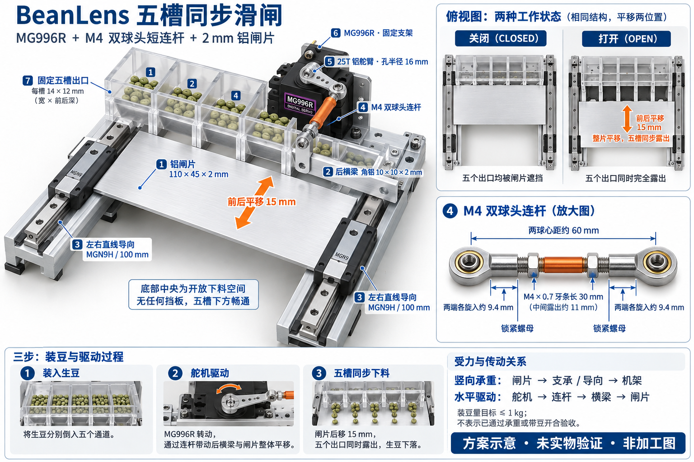

# BeanLens 五槽滑闸装配概念图

日期：2026-10-12。使用内置image_gen工具生成，未使用CLI/API回退。



依据：[配件选型](../GATE-PARTS-20261012.md) 与 [运动修正建议](../GATE-REVISION-20261012.md)。

用途：说明一个MG996R经双球头短连杆、中心连接耳和后横梁带动整片闸门，两侧导向约束平移；附五槽开合与连杆尺寸示意。

状态：生成式概念插图，外形、透视、零件比例及标注位置不属于尺寸检验。主图和小图的观察方向不同；推/拉对应开闸还是关闸须按实际布置标定。零件准确尺寸以配件说明中的原厂图纸和到货实物为准。支架孔位、实际安装包络、1kg承载和带豆开合尚未验证，不作加工图或装配验收依据。

## 使用的完整生成提示

```text
+Use case: scientific-educational / infographic-diagram.
Create ONE polished, high-resolution landscape Chinese mechanical assembly illustration for BeanLens coffee green-bean inspection machine, based on the following specific proposed mechanism. It should help a hardware beginner assemble and understand the device. Crisp engineering textbook rendering, realistic machined parts, axonometric 3D main illustration, restrained white/off-white background, navy readable Chinese labels, silver aluminum, dark blue guides, black hobby servo, orange short linkage and motion arrows, green beans only in a tiny inset. Excellent readable typography and generous spacing.

Title exact Chinese: "BeanLens 五槽同步滑闸"
Subtitle exact: "MG996R + M4 双球头短连杆 + 2 mm 铝闸片"

LAYOUT: main left 65%: large axonometric assembled mechanism with a slightly lifted semi-transparent fixed five-channel outlet block so its relationship to the sliding plate can be seen; right upper 35%: compact top-view two-state diagram "关闭" and "打开", same geometry at two positions; right lower: enlarged actual short linkage with accurate dimensional labels. Bottom: compact 3-step load and drive explanatory labels. Do not fill image with long paragraphs.

MECHANICAL GEOMETRY — MUST FOLLOW:
- Coordinate X runs left-right across FIVE adjacent bean channels, Y front-back is the sliding direction, Z vertical is gravity.
- A single SOLID RECTANGULAR horizontal silver gate plate is 110 mm in X by 45 mm in Y by 2 mm thick. NO holes or slots cut into the moving gate plate. A straight leading edge spans the entire width. The plate never rotates.
- Above its leading region is a FIXED translucent outlet block with exactly FIVE rectangular openings lined up LEFT TO RIGHT at identical front-back Y coordinates; each clear opening 14 mm wide by 12 mm front-back depth. Show solid partitions. This fixed outlet block is independently mounted to frame, not carried by the plate.
- Plate retracts BACKWARDS in Y by 15 mm, perpendicular to the line of five openings, simultaneously uncovering all five. A straight double-headed orange arrow front-back labels "前后平移 15 mm". Do not show sideways travel across the channel row.
- Left and right OUTSIDE the five-channel drop corridor are two parallel 100 mm miniature linear rails, axes front-back Y. ONE long slider block per rail (MGN9H style). The two slider blocks are rigidly connected by a silver angle-aluminum transverse rear crossbar, across X at the BACK edge of the plate. The plate is bolted to this crossbar. No crossbar runs through the falling bean openings.
- On a common rigid fixed open-center base/frame, both rails are fixed and slide blocks move. Base/frame has an unobstructed large central opening below all five bean channels; never a solid support plate blocking beans.
- Small fixed POM support lands underneath the gate align with side walls and partitions, leave all five drop openings clear. Make them understated.
- ONE MG996R position servo is mounted rigidly centered BEHIND the rear crossbar, outside the bean drop corridor. Its shaft is VERTICAL (Z), short silver single-arm horn rotates in horizontal plane. Use a 25-tooth horn with linkage attachment at 16 mm radius. Horn should be visibly short.
- An orange straight short push-pull rod with METAL SPHERICAL EYE ENDS at BOTH ends links servo horn pin to the CENTER of rear crossbar. Both spherical eye ends have 4 mm through bolts. The linkage centers are 60 mm apart; overall linkage about 74 mm. NOT a 60 mm exposed thin rod: show bulky eye ends and only about 11 mm exposed M4 threaded center segment with TWO locknuts.
- Linkage/horn pivot plane is elevated slightly above gate; a rigid central raised tab on rear crossbar connects linkage at same height. Do not invent vertical diagonal forces or make linkage enter any bean opening. Heights are schematic, do not dimension support heights.
- Servo body, rail bases, fixed channel block are fixed; silver gate, crossbar and two sliders translate together as a rigid assembly. No second servo, no drive belt, no lead screw, no rack.
- Ensure horn/rod/bolts actually connect; rails face same direction and blocks sit on rails. Perspective consistent. Machine scale is small, gate only 11 cm wide.

LABELS with clean leader lines, use these concise Chinese labels:
"① 铝闸片 110 × 45 × 2 mm"
"② 后横梁 角铝 10 × 10 × 2 mm"
"③ 左右直线导向 MGN9H / 100 mm"
"④ M4 双球头连杆"
"⑤ 25T 铝舵臂 · 孔半径 16 mm"
"⑥ MG996R · 固定支架"
"⑦ 固定五槽出口"
The linkage detail labels exact: "两球心距约 60 mm", "M4 × 0.7 牙条长 30 mm", "两端各旋入约 9.4 mm", "锁紧螺母".
Top-view CLOSED: five fixed outlet openings all covered by solid plate. OPEN: same solid plate shifted backwards 15mm all FIVE openings fully clear, not five holes in the plate. Both views show same left/right rails. Arrow labels "整片平移，五槽同步露出".
Bottom concise text: "竖向承重：闸片 → 支承 / 导向 → 机架" and "水平驱动：舵机 → 连杆 → 横梁 → 闸片".
Small prominent footer exact: "方案示意 · 未实物验证 · 非加工图"
Also small note: "装豆量目标 ≤ 1 kg；不表示已通过承重或带豆开合验收".
Do not show food-contact certification or verified force/performance. No ornamental irrelevant parts, no extra openings, no overlapping labels, no unrealistic razor blade edge, no dimensioning connecting-rod length as bare rod 60mm.
```
