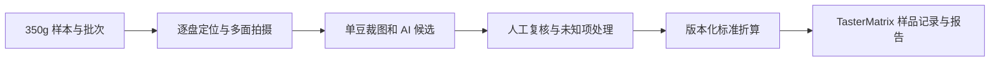

# BeanLens 豆鉴：生豆矩阵扫描与 AI 验收台参赛研究

核查日期：2026-10-08。本文为选题与实现建议，尚未训练模型、制作硬件或验证准确率。比赛要求来自用户提供的 WTCC 海报与[主办社区活动页](https://ai.builderlab.cn/)。优先核查标准制定者、芯片厂商、模型厂商和研究作者；产品性能自述不等于独立验证。

## 建议与定位

优先推进 LIVE 赛道：**豆鉴 BeanLens——让每一次生豆验收，都有可复核的证据。**

服务烘焙厂、进口商与产地收购 QC：固定成像、多面逐豆检查、人工复核、按标准规则计算、关联 TasterMatrix 样品与杯测记录。首版默认水洗阿拉比卡；其他处理法与罗布斯塔分别采样验证。硬件直接创造一致光线、尺度与视角，能够体现 AI、硬件和交互的完整体验。

相比通用陪伴或训练装置，这一方向与项目专业场景结合更直接，也更容易给出漏检、折算误差与操作耗时等可验证结果。题目本身不能推出获奖概率；未知参赛作品、评委构成及最终规则时不提供虚构百分比。

## 标准口径：三个指标必须分开

SCA 当前仍将 SCA-110 绿咖啡贸易分级标准列为制定中；CVA Physical 官方说明基于 2004 绿咖啡分级体系。[标准状态](https://sca.coffee/research/coffee-standards)、[CVA 官方说明](https://sca.coffee/value-assessment)。不能声称已采用“2026 新颁布 SCA-110”。

可访问依据是 [SCA Protocols & Best Practices，2018，SCA 原文镜像](https://www.scith.coffee/wp-content/uploads/2021/03/SCA-Protocols-_-Best-Practices.pdf)，第 4–6 页：完整样本 350g；各类型折算为整数 full defects，向下取整；同豆多种瑕疵只按对杯质影响最大的一种计。酸豆还需区分豆体发红与仅银皮发红。这是 SCA 原文的第三方存储镜像，不是新版标准发布。

产品分别展示：

- **可见瑕疵豆占比**：在已检查咖啡豆中，最终确认至少一种可见瑕疵的独立豆数量 / 已检查豆数量。未知豆另报；异物另计，不放进咖啡豆分母。
- **样本检查进度**：总样本重量、已检查盘数、遗漏或不适配托盘的物料、待复核数量。100 格是一盘设备容量，不代表 350g 标准样本。
- **完整瑕疵数**：完整样本各类型原始数量先累积，再按该类型折算数向下取整，最后按 Category 1/2 分别相加。

推荐计算结构：

```text
每类完整瑕疵数 = floor(完整样本该类原始数量 / 该类折算数)
Category 完整瑕疵数 = sum(该 Category 各类型完整瑕疵数)
```

例如 broken/chipped/cut 每 5 个折算 1 个完整瑕疵：两盘各 3 个，应先累积 6 个，得到 1；逐盘取整会错误地得到 0。不同类型的余数不能拼成一个完整瑕疵。复拍同一豆不能增加豆数。

完整类别表、优先序与阈值须按采用的正版手册版本复核并版本化保存。视觉模型输出可保存多个候选瑕疵，计数账本仍须依标准优先序选一个类别。未覆盖类别、未处理物料与待复核项存在时，结果保持预筛/未完成，不能直接输出完整分级或 SCA 认证。

物理外观瑕疵不等于杯中感官瑕疵，图像识别不能替代整个 CVA Physical 的水分、粒度等检查。浮豆密度、酸豆内部颜色、未熟豆银皮状态、气味等可能需要补充测试；真菌损伤外观疑似不等于毒素检验。首版应允许拒判与人工确认。

## ESP32、API 与专用模型

| 路线                             | 能力与条件                                                                 | 本项目建议                                 |
| -------------------------------- | -------------------------------------------------------------------------- | ------------------------------------------ |
| ESP32-S3 / P4 + ESP-DL           | 有现成推理框架；需要自训小模型、量化、检查算子与内存，并重新验收量化后表现 | 后续用于固定拍摄条件下、已经验证的单豆分类 |
| 摄像头 + 电脑/服务器专用分类模型 | 可使用更高分辨率与较大的模型；需真实样本和专家标签                         | 若能取得足够数据，优先作为可控的分类主引擎 |
| 摄像头 + 视觉语言模型 API        | 快速形成原型，可结合参考图片与多面证据；成本、延迟、误判需实测             | 四天 MVP 的启动方案，保留人工复核          |
| 混合                             | 小模型处理已验证类，API/专家处理未知与争议                                 | 长期推荐，但赛中不要同时铺开全部路线       |

[Espressif ESP-DL](https://github.com/espressif/esp-dl)支持模型加载与量化，官方也提供[ESP32-S3 上 MobileNetV2 分类示例](https://developer.espressif.com/workshops/edge-ai-with-esp32-s3/assignment-5/)。这证明小型分类器部署路径存在，不证明咖啡分类性能。没有核到可直接烧录、完整覆盖 SCA 生豆瑕疵且已验证的现成权重。训练在电脑上完成；ESP32 承担推理，不是在板上训练大模型。完整通用视觉语言模型不适合放进普通 ESP32。

矩阵已经给出对象位置，首版可以直接逐格裁图，训练 MobileNetV2 小型单豆分类器；不必先解决全盘复杂目标检测。虫孔等微小结构是否能识别，要先检验原始图像和输入缩小后的细节，再决定输入尺寸和模型。

API 初测候选（截至核查日可用型号；不是咖啡准确率排名）：

| 候选                                 | 初测用途                                             | 官方来源                                                                                                |
| ------------------------------------ | ---------------------------------------------------- | ------------------------------------------------------------------------------------------------------- |
| Qwen3-VL Plus，`qwen3-vl-plus`       | 中国现场原型优先试接，实际账号区域、网络与延迟先验收 | [阿里云视觉模型列表](https://www.alibabacloud.com/help/en/model-studio/model-list-visual-understanding) |
| GPT-6.1 Sol，`gpt-6.1-sol`           | 对同一专家标注集做比较                               | [OpenAI 模型文档](https://developers.openai.com/api/docs/models)                                        |
| Gemini 3.8 Flash，`gemini-3.8-flash` | 比较识别结果、响应时间与单样本成本                   | [Google 模型文档](https://ai.google.dev/gemini-api/docs/models)                                         |

哪一个“最适合咖啡”目前没有足够的公开同条件基准支持结论。先使用同一批、同一成像条件、同一类别定义的图片比较，而不是依据综合视觉榜单选赢家。长期优先域内监督分类器；API 可解释候选、辅助复核，不承担标准数学规则。

[OpenAI 图像文档](https://developers.openai.com/api/docs/guides/images-vision)明确提示计数、空间定位与准确率限制。因此不要直接上传整盘，要求模型数出 100 豆与所有瑕疵。系统先校正托盘坐标、检查空格/双豆/模糊，再裁出有编号的单豆图片；按有界小批量提交，验证所有返回编号，保存无结果与拒判项。模型自报置信度不能直接当作真实概率，需要独立校准。

每颗豆至少保存：样本 ID、盘次、格位 ID、各视角原图与裁图、候选类别及外观依据、最终人工确认类别、模型版本、规则版本、复核人和修改记录。API 密钥留在服务器；设备只发图片与控制事件。

## 托盘：核心价值是固定身份与真正翻面

建议先做 5×5 机械试验，再扩至 10×10。固定格位让模型输入标准化，让人能找到并复查被标出的豆。

不要直接使用深螺丝孔：孔壁会遮挡侧面，破碎豆和虫孔可能消失。采用低边沿、浅窝或通孔网格加可拆底板；颜色先比较哑光黑/中性灰的成像表现，避免反光、透色和强阴影。尺寸根据实际豆大小分布调整，不先拍脑袋固定孔径。

翻面方案：

1. A 盘装豆，固定相机拍第一面。
2. B 盘与 A 对位，锁扣夹住，各格仍相互隔离。
3. 整体倒转，移除原支撑盘，拍被暴露的另一面。
4. 软件依据非对称角标与机械翻转方向做格位映射，把第二面合并回原 bean ID。

这只是待验证的机械方案：必须观察豆是否真正换面、是否卡住、掉落、串格或刮碎。平面转动 180°只是改变朝向，不等于看到另一面。必要时补斜向光/第三视角，不能宣称双面涵盖全豆表面。

快速上料可以试“倒入—轻振—刮平—空格/双豆提示—少量人工修正”。若需要逐豆手放，整体速度可能输给手拣。托盘放不下的碎片、超大豆、带壳物、异物与残余物料必须另盘处理并归入原样本，否则好装盘的豆被优先选入，会使瑕疵比例偏低。

把全部豆倒出随机重排会丢失身份；这种复拍只能作为重复样本观察，不能跨图片累加豆数。相同照片重复调用模型也不能当作独立测量。应验证的是“新增视角是否降低漏检”，而不是“多问几次是否得出相同答案”。

## 推荐硬件组成与成像验收

首版：遮外光的小箱、固定相机架、可锁定曝光与白平衡的近距离相机、漫射光源、灰/色参照块、角标、对位翻面托盘、ESP32-S3 控制按钮与光源，以及现场电脑。

可用 [XIAO ESP32S3 Sense](https://wiki.seeedstudio.com/xiao_esp32s3_getting_started/)验证控制与低成本拍摄路径，当前官方页列出 OV3660。但不把入门 ESP32 相机默认当作全盘细小虫孔的最终传感器；USB 高分辨率相机配电脑也是有效参赛方案。画面里豆的有效像素、对焦、镜头解析力与照明比标称像素更重要。必要时分四个区域拍摄，再回归同一矩阵坐标。

采购/制作前先做三个低成本验证：

- 在实际拍摄距离下，专家能否从原图分辨最小目标虫孔和色差；模型输入压缩后是否还存在这些信息。
- 5×5 对位托盘连续翻转，逐格检查身份和暴露视角；记录失败原因。
- 从散豆开始计时到完整报告结束，包含上料、翻面、网络推理、人工纠错、卸料；与同批专家手工检查比较。

暂不提供未经询价的采购总价或准确率承诺。先用现有相机/电脑和打印托盘证明上述条件，再决定购买板卡和镜头。

## 数据与有效测试

现有[作者 17 类泰国生豆数据集](https://www.kaggle.com/datasets/sujitraarw/coffee-green-bean-with-17-defects-original)与[2024 作者论文](https://doi.org/10.1016/j.atech.2024.100680)可参考。979 原图经旋转扩增为 6853；没有 healthy 和 foreign matter，类别也不是与标准一一对应。当前公开许可字段 Unknown，不能直接认定可商用。论文的未见数据表现也低于交叉验证表现，不能把论文高分当作本装置指标。

优先自采真实豆、取得专家确认。初版先做正常豆 + 3–5 个有足够样本的明显外观类别，例如黑豆、破碎、贝壳、虫损疑似，再加未知/待复核；全黑/局部黑等最终划分仍按专家与手册口径。所有其他标准类别可由人工录入，使计数引擎完整；不能把未覆盖类别自动归为正常。

几十至百颗独立豆/类可以启动试验，不代表已具备跨产区部署能力。每颗豆采集不同面、照明与拍摄批次，标签保留专家分歧；银皮、处理法与产地色泽变化都需要进入后续验证。

训练、验证、测试按物理豆及批次划分；同一颗豆的翻面/旋转图片不能混入训练与测试两端。留一批模型从未见过的真实样本用于现场测试。

建议报告：各类型查准率/召回率、Category 1 漏检、未知率与人工纠正量、各类别完整瑕疵数与专家结果差、格位身份保持率、单面与多面对同一批豆的比较、完整 350g 工作流耗时。类别不平衡时“总准确率 95%”可能掩盖全部少见严重瑕疵漏检。边界未知时不强制输出伪确定类别。

## TasterMatrix 整合边界

本次核实的 `vps-backend/src/services/event-analytics/defect-prevalence.ts` 中 `summarizeDefectReports`，现有口径是有效评测员报告中“报告感官瑕疵”的比例，分母为 `valid-evaluator-reports`。这不能复用为物理豆瑕疵率。

建议新增“生豆物理检查”记录，以样品/批次关联既有验收杯测和活动报告；展示两套独立证据：物理外观原始计数及复核，与杯中感官风险记录。不要从外观模型直接推断杯测分数、风味或自动采购结论。

首版链路：



## 比赛竞争力与已有产品

[Sucafina 2024 第一手采访](https://www.sucafina.com/NA/news/faster-green-grading-with-csmart-digit)描述 Csmart Digit 已采用逐豆传送带、相机、神经网络进行绿分级，并计划连接品饮记录；其约 350g/4 分钟是使用方自述，未核到独立准确率。[BeanGrader](https://beangrader.com/)也已有单照片裁豆、候选类别与人工查看。因此“AI 看豆”和“连接杯测”本身都不应称首次创新。

能争取的差异是：低成本桌面结构、可保持身份的多面观察、让普通 QC 看得懂的逐豆证据与纠错体验、完整样本正确折算、在本项目现有业务中真正可使用。差异是否成立需实测成本、时间和漏检变化，不能只凭概念。

用户海报的真实问题、可运行核心、AI/硬件/交互、赛中增量、值得继续验证五个关注点，都可以对应到此方案。咖啡是专业人群，LIVE 的工作与效率方向可承接；要在首日现场观察后确认目标用户和具体瓶颈。

类似赛事已核获奖作品 [气味打印机](https://devpost.com/software/a-printer-for-smell-ai-scent-songs)获 Best in Robotics，[RoboChef](https://devpost.com/software/robochef-gpt-oss-powered-kitchen-assistant)获 Best Overall。可借鉴实体链路、现场可感知结果与完整演示；样本不能推出统计获奖率。对于本题，评委亲自放豆、翻面发现问题并修正报告，比只播放识别视频更有说服力。

## 四天 MVP 与演示

赛前准备：相机成像试验、5×5 翻面结构、专家标签与模型小样本比较、核心物料备份；如实披露 TasterMatrix 既有功能及赛前原型进度。保留一个尚未完成、能在赛中验证的明确增量。

| 时间       | 可交付增量                                                                 |
| ---------- | -------------------------------------------------------------------------- |
| 10/22      | 现场观察与目标问题确认；跑通一次拍摄、逐格裁图与未知提示                   |
| 10/23      | 对位翻面、格位身份映射、多面候选合并与图像证据                             |
| 10/24      | 人工复核、跨盘原始计数、标准折算；连接 TasterMatrix 样品记录，测试未见样本 |
| 10/25 上午 | 完整操作计时、修复翻面与网络失败、准备现场演示和实测结果                   |

演示情节：评委把包含明显瑕疵与未见豆的样本放入托盘 → 首面识别候选 → 翻面露出首面看不到的孔或破损 → 系统仍认为是同一颗豆 → 人工查看证据并确认 → 展示原始数量与标准折算 → 打开对应样品记录。精心挑选的演示豆只能证明功能；准确率来自独立测试。

如果没有跑完完整 350g，仅演示“25/100 豆可见瑕疵预筛”；完整样本报告继续由逐盘处理与人工覆盖补齐。不得为舞台效果把少量演示豆数学放大成已完成的 350g 检验。

最先推进的工作是专家样本、成像和翻面身份验证。三者成立后，AI 集成与计数引擎才有可靠输入。此文为研究结果，尚未开展源码实现、采购或设备制作。
